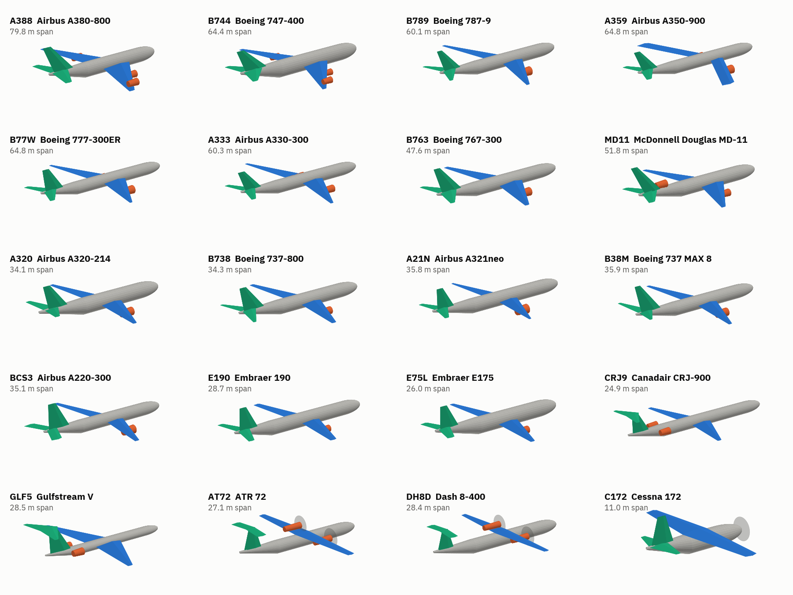
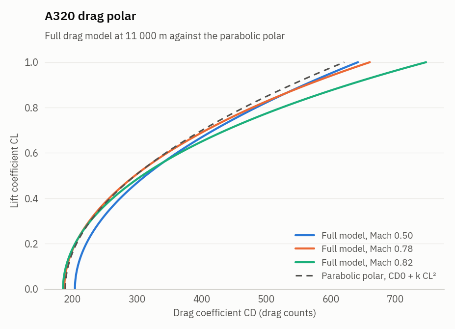
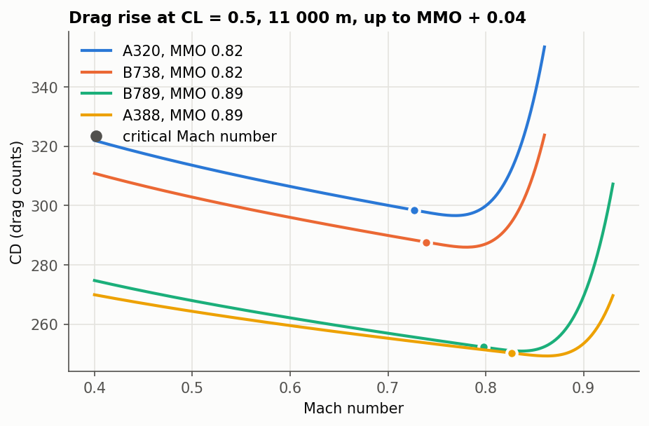
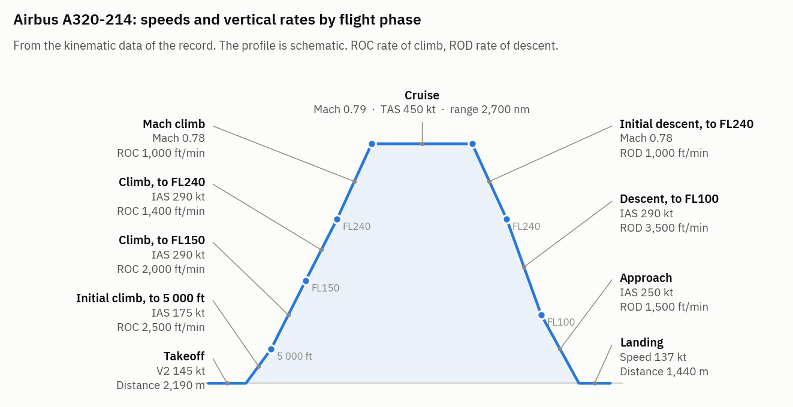

# Aerox

Aerox is an open aircraft performance toolbox. It provides detailed aircraft
data and performance models, such as drag models, for **140+ aircraft types**.
The models are physical models built from open data.

Aerox is the successor to [OpenAP](https://github.com/junzis/openap). It covers
more of each aircraft than OpenAP does, and it is more accurate.

A selection of the aircraft, each drawn from its record:



## Install

```bash
pip install aerox
```

Or, from a copy of the repository:

```bash
pip install .
```

Add the `plot` extra (`pip install "aerox[plot]"`) to draw aircraft with
Matplotlib.

## Quick start

### Aircraft

Load an aircraft:

```python
from aerox import load_aircraft, get_available_aircraft

ac = load_aircraft("A320")
print(ac.mtow, ac.wing.area, ac.wing.span)

print(get_available_aircraft())
```

### View an aircraft in 2D and 3D

The `aerox` command opens an aircraft viewer in the browser:

```bash
aerox view                 # all aircraft
aerox view A320 B789       # only these aircraft
aerox view --out a320.html A320   # write the page to a file instead
```

The viewer shows each aircraft in 3D and as a 2D three-view, with dimensions
and a scale. Click a part to see its dimensions and where each value comes
from. The server runs on `http://127.0.0.1:8765` until you press Ctrl+C. Use
`--port` to change the port and `--no-open` to keep the browser closed. The
page loads three.js from a CDN, so it needs an internet connection.
`python -m aerox view` does the same.

The same drawings are available in Python, with the `plot` extra:

```python
from aerox.plot import three_view, view_3d

three_view(ac).savefig("a320-three-view.png")
view_3d(ac)
```

The drawings are outline models. The sizes come from the record. The positions
of the wing, tails, and engines along the fuselage follow simple rules, so they
are approximate.

### Drag model

Aerox gives drag in two forms. Both have a `cd()` method (an alias of
`drag_coefficient()`) that returns the drag coefficient at a flight condition.

| | `build_drag_model(ac)` | `build_parabolic_polar(ac)` |
| --- | --- | --- |
| Returns | the full drag model | `CD = cd0 + k CL²` |
| Changes with Mach and Reynolds number | yes | no, fixed at the reference condition of the record |
| Wave drag | yes | no |
| Use it for | performance at a flight condition | quick estimates and closed-form analysis |

The full model, at a flight condition:

```python
from aerox.models.drag import build_drag_model

model = build_drag_model(ac)
print(model.cd(cl=0.55, mach=0.78, h=11_000))   # altitude in m, ISA
```

With the altitude `h`, the model computes the Reynolds number from the ISA
atmosphere. Add `dT=` for a temperature offset from ISA, or pass
`reynolds_per_m=` instead of `h` to give the Reynolds number yourself.

The parabolic polar, the same at every flight condition:

```python
from aerox.models.drag import build_parabolic_polar

polar = build_parabolic_polar(ac)
print(polar.cd0, polar.k)
print(polar.cd(cl=0.55))
```

Near the reference cruise condition of the record, and at cruise lift
coefficients, the two agree within a few percent. Away from that condition, or
at high lift coefficients where wave drag appears, use the full model. See
[the drag docs](docs/drag.md) for details.





What each part of the aircraft contributes to the drag:


The maximum lift-to-drag ratio of every turbofan aircraft in the database:


### Kinematics

Each record also has the typical speeds and vertical rates of each flight
phase, from takeoff to landing:

```python
k = ac.kinematic
print(k.climb_to_fl150_ias)   # 290 kt
print(k.climb_to_fl150_vs)    # 2000 ft/min
print(k.cruise_mach)          # 0.79
print(k.cruise_range_nm)      # 2700 nm
```

The A320 values, phase by phase (see [the kinematics docs](docs/kinematics.md)
for all fields):



### Atmosphere and speeds

Atmosphere and speed conversions, in SI units:

```python
from aerox import aero

p, rho, T = aero.atmos(h=10_000)           # altitude in m
cas = aero.mach2cas(mach=0.78, h=10_000)   # m/s
```

## What is included

- **Aircraft data.** One YAML record per type with geometry, mass limits, and
  engine data. Each geometry and mass value has a source note under
  `src/aerox/data/aircraft/sources`.
- **Drag.** A drag model computed from the aircraft geometry: skin friction
  and form factors for the wing, fuselage, tails, nacelles, and pylons, plus
  wave drag and induced drag, and drag increments for deployed flaps and
  landing gear. No value is fitted to another performance model.
- **Drawings.** `aerox view` and `aerox.plot`, 2D and 3D outline drawings of
  each aircraft.
- **Kinematics.** Typical speeds and vertical rates of each flight phase, for
  every aircraft.
- **Atmosphere and speeds.** `aerox.aero`, ISA atmosphere and
  CAS/TAS/EAS/Mach conversions.
- **Flight management.** `aerox.fms`, route, altitude and speed intent, and
  guidance primitives.

## Current accuracy and limits

- At cruise, the drag model agrees with a reference performance model within
  5 % for most jet transports. At lower Mach numbers (about 0.6) it is 4 to
  12 % too high.
- Flap and landing gear drag come from simple handbook methods. Slats add no
  drag, and spoiler drag is not modelled.
- The modules for thrust, lift, flight dynamics, and simulation are
  experimental. Their interfaces can change.

## Sources

- **Aircraft data.** Type certificate data sheets (EASA, FAA, Transport
  Canada, CAA New Zealand), manufacturer airport planning documents, and
  manufacturer CAD drawings (Airbus, Boeing), from which the wing and tail
  geometry is measured. Military types use NASA technical reports and USAF
  fact sheets. Every geometry and mass value in a record has a source note
  under `src/aerox/data/aircraft/sources`. The cited documents are listed in
  `sources/sources.yml`, and the drawings and measurement tables are in
  `sources/`. Values not yet traced to such a document are marked
  `legacy-unverified`. The kinematic values have no source notes yet.
- **Drag methods.** Component drag build-up after Raymer, Kroo, and Scholz,
  nacelle and pylon terms after FLOPS and SUAVE, and wave drag from the Korn
  equation with Lock's fourth-power law.
- **Atmosphere.** `aerox.aero` is ported from `openap.aero` (OpenAP 2.6.0).

## Documentation

See [`docs/`](docs/README.md) for the aircraft data, the drag model, the
kinematics, the atmosphere functions, and the roadmap.

## Development

```bash
uv sync --all-extras   # the tests need every extra
uv run pytest -q
uv run --extra editor tools/web_editor.py   # local editor for aircraft records
uv run --extra research tools/make_readme_figures.py   # figures in docs/figures
```

## Licence

GNU Lesser General Public License v3 (LGPL v3). See `LICENSE`.
