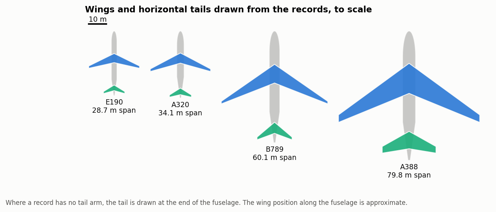
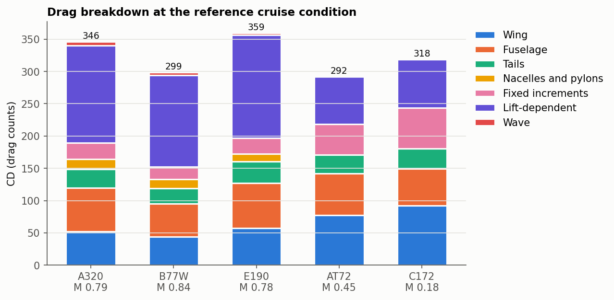
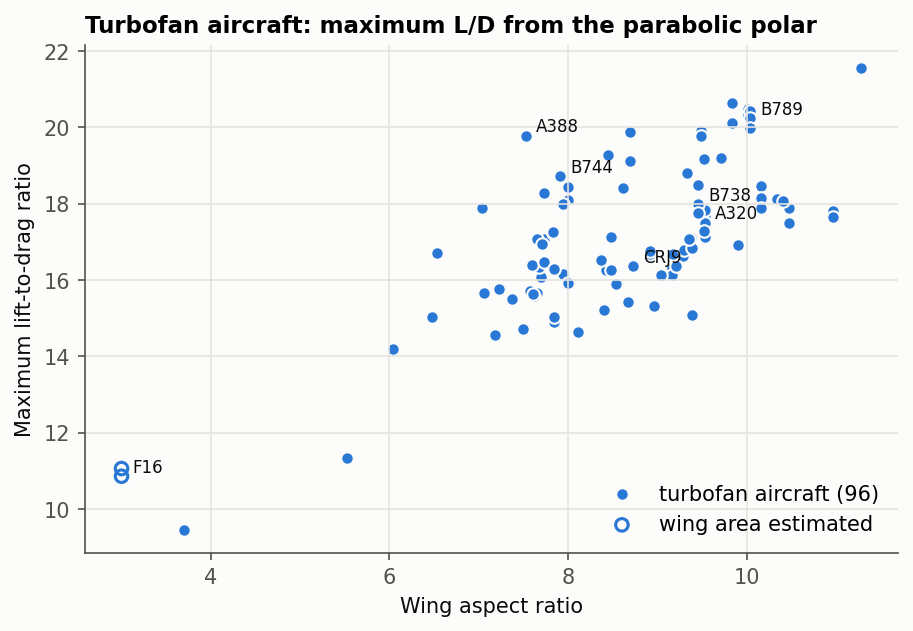

# Aerox

Aerox is an open aircraft performance toolbox (similar but differs to OpenAP). It
gives you comprehensive aircraft data and performance models for 144 aircraft types, built with physical models from open sources.

```bash
pip install aerox
```

Or, from a copy of the repository:

```bash
pip install .
```

## Quick start

### Aircraft

Load an aircraft:

```python
from aerox import load_aircraft, get_available_aircraft

ac = load_aircraft("A320")
print(ac.mtow, ac.wing.area, ac.wing.span)

print(get_available_aircraft())
```



### Drag model

Aerox gives drag in two forms. Both have the method `cd()` (an alias of
`drag_coefficient()`) to obtain the drag coefficient at different flight conditions.

| | `build_drag_model(ac)` | `build_parabolic_polar(ac)` |
| --- | --- | --- |
| Returns | the full drag model | `CD = cd0 + k CL²` |
| Changes with Mach and Reynolds number | yes | no, fixed at the reference condition of the record |
| Wave drag | yes | no |
| Use it for | performance at a flight condition | quick estimates and closed-form analysis |

The full model, at a flight condition:

```python
from aerox.models.drag import build_drag_model

model = build_drag_model(ac)
print(model.cd(cl=0.55, mach=0.78, h=11_000))   # altitude in m, ISA
```

With the altitude `h`, the model computes the Reynolds number from the ISA
atmosphere. Add `dT=` for a temperature offset from ISA, or pass
`reynolds_per_m=` instead of `h` to give the Reynolds number yourself.

The parabolic polar, the same at every flight condition:

```python
from aerox.models.drag import build_parabolic_polar

polar = build_parabolic_polar(ac)
print(polar.cd0, polar.k)
print(polar.cd(cl=0.55))
```

Near the reference cruise condition of the record, the two agree within a few
percent at cruise lift coefficients. Away from that condition, or at high lift
coefficients where wave drag appears, use the full model. See
[the drag docs](docs/drag.md) for details.


The breakdown shows what each aircraft part contributes:



The maximum lift-to-drag ratio of every turbofan aircraft in the database:



Atmosphere and speed conversions, in SI units:

```python
from aerox import aero

p, rho, T = aero.atmos(h=10_000)           # altitude in m
cas = aero.mach2cas(mach=0.78, h=10_000)   # m/s
```

## What is included

- **Aircraft data.** One YAML record per type with geometry, mass limits, and
  engine data. Each value has a source note under
  `src/aerox/data/aircraft/sources`.
- **Drag.** A clean-configuration drag model that is computed from the aircraft
  geometry: skin friction and form factors for the wing, fuselage, tails,
  nacelles, and pylons, plus wave drag and induced drag. No value is fitted to
  another performance model.
- **Atmosphere and speeds.** `aerox.aero`, ISA atmosphere and
  CAS/TAS/EAS/Mach conversions.
- **Flight management.** `aerox.fms`, route, altitude and speed intent, and
  guidance primitives.

## Current accuracy and limits

- The drag model agrees with a reference performance model within 5 % at
  cruise for most jet transports. But at lower Mach numbers (about 0.6) it is 4 to
  12 % too high.
- Drag is for the clean configuration only. Flap, slat, and landing gear
  increments are not included yet.
- The modules for thrust, lift, flight dynamics, and simulation are
  experimental. Their interfaces can change.

## Sources

- **Aircraft data.** Type certificate data sheets (EASA, FAA, Transport
  Canada, CAA New Zealand), manufacturer airport planning documents, and
  manufacturer CAD drawings (Airbus, Boeing), from which the wing and tail
  geometry is measured. Every value in a record has a source note under
  `src/aerox/data/aircraft/sources`. The cited documents are listed in
  `sources/sources.yml`, and the drawings and measurement tables are in
  `sources/`. Values not yet traced to such a document are marked
  `legacy-unverified`.
- **Drag methods.** Component drag build-up after Raymer, Kroo, and Scholz,
  nacelle and pylon terms after FLOPS and SUAVE, and wave drag from the Korn
  equation with Lock's fourth-power law.
- **Atmosphere.** `aerox.aero` is ported from `openap.aero` (OpenAP 2.6.0).

## Documentation

See [`docs/`](docs/README.md) for the aircraft data, the drag model, the
atmosphere functions, and the roadmap.

## Development

```bash
uv run pytest -q
uv run --extra editor tools/web_editor.py   # local editor for aircraft records
uv run --extra research tools/make_readme_figures.py   # figures in docs/figures
```

## Licence

GNU Lesser General Public License v3 (LGPL v3). See `LICENSE`.
