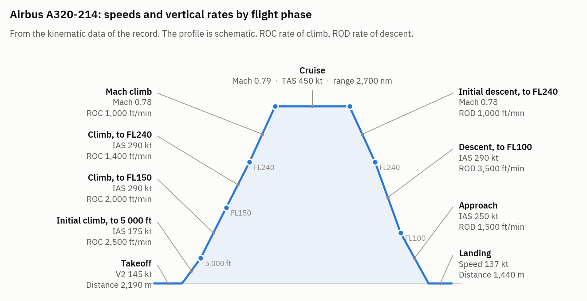

# Kinematics

Each aircraft record has a `kinematic` section: the typical speeds and vertical
rates of each flight phase, from takeoff to landing. They describe a nominal
flight, not the limits of the aircraft. Use them to build simple climb and
descent profiles, or as reference values for trajectory models.

```python
from aerox import load_aircraft

k = load_aircraft("A320").kinematic
print(k.climb_to_fl150_ias, k.climb_to_fl150_vs)   # 290 kt, 2000 ft/min
print(k.cruise_mach, k.cruise_range_nm)            # 0.79, 2700 nm
```

`aerox.models.kinematics.load_kinematic_parameters("A320")` returns the same
section directly from the ICAO code.



## Phases and fields

The phases follow the layout of the EUROCONTROL Aircraft Performance Database
(APD). Speeds are indicated airspeed (IAS) in knots unless given as a Mach
number. Vertical rates are positive in ft/min, for both climb and descent.

| Phase | Altitude band | Fields | Units |
| --- | --- | --- | --- |
| Takeoff | ground | `takeoff_distance_m`, `takeoff_v2` | m, kt |
| Initial climb | 0 to 5 000 ft | `climb_to_fl50_ias`, `climb_to_fl50_vs` | kt, ft/min |
| Climb | 5 000 ft to FL150 | `climb_to_fl150_ias`, `climb_to_fl150_vs` | kt, ft/min |
| Climb | FL150 to FL240 | `climb_to_fl240_ias`, `climb_to_fl240_vs` | kt, ft/min |
| Mach climb | above FL240 | `mach_climb_mach`, `mach_climb_vs` | Mach, ft/min |
| Cruise | cruise level | `cruise_mach`, `cruise_tas`, `cruise_range_nm` | Mach, kt, nm |
| Initial descent | down to FL240 | `descent_to_fl240_mach`, `descent_to_fl240_vs` | Mach, ft/min |
| Descent | FL240 to FL100 | `descent_to_fl100_ias`, `descent_to_fl100_vs` | kt, ft/min |
| Approach | below FL100 | `approach_ias`, `approach_vs` | kt, ft/min |
| Landing | ground | `landing_distance_m`, `landing_ias` | m, kt |

`takeoff_v2` is the takeoff safety speed V2.

The Mach-phase fields are `None` for aircraft without a Mach phase: all piston
aircraft, all but one turboprop, and three turbofans.

## Example: time to climb

Flying each climb phase at its vertical rate gives the time to climb.

```python
k = load_aircraft("A320").kinematic

segments = [
    (0, 5_000, k.climb_to_fl50_vs),
    (5_000, 15_000, k.climb_to_fl150_vs),
    (15_000, 24_000, k.climb_to_fl240_vs),
    (24_000, 35_000, k.mach_climb_vs),
]
minutes = sum((top - bottom) / rate for bottom, top, rate in segments)
print(f"{minutes:.1f} min to FL350")   # 24.4 min
```

The profile is a step model: the vertical rate changes at the phase
boundaries and is constant within a phase. It does not account for mass,
temperature, or wind. For those, use the drag and thrust models.

## Sources and accuracy

The kinematic values come from the original aerox database. They are typical
values, given as round numbers, and are not yet traced to a document. Unlike
the geometry and mass fields, they have no source notes yet, so treat them as
nominal values for a typical flight.
